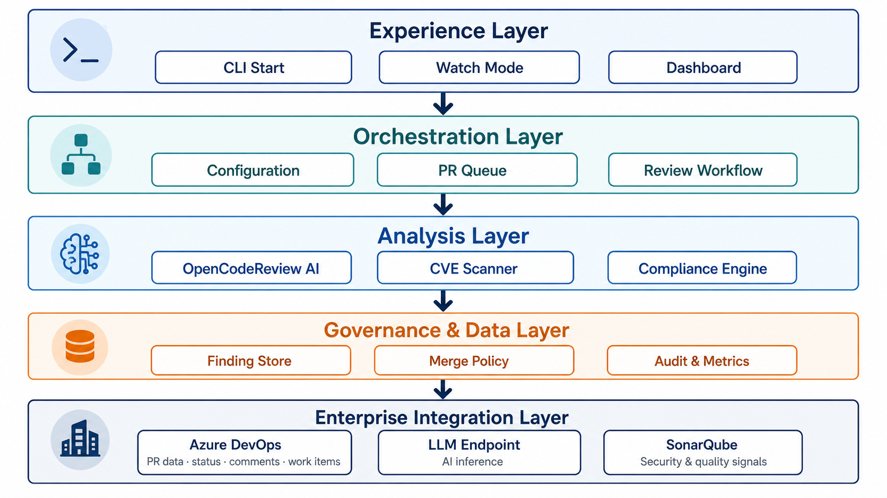

# RATAN Code Review Agent

## Leadership Presentation with Integrated Speaker Notes

**Session:** 20-minute presentation + 10-minute Q&A
**Narrative:** The initial implementation demonstrated the value of AI-assisted review. The next version turns that capability into a lightweight, configurable, governed, and reusable engineering product.

> Each slide contains concise presentation content followed by detailed speaker notes.

---

## Slide 1 — What Is RATAN Code Review Agent?

### Presentation content

RATAN Code Review Agent is an AI-assisted engineering control that reviews Azure DevOps pull requests before approval.

It applies configurable review standards and relevant project context to identify code defects, test gaps, security concerns, and release risks, then presents actionable findings to support faster, more consistent, and better-informed human review.

### Speaker notes

RATAN Code Review Agent provides an automated first review for Azure DevOps pull requests. It detects defects, test gaps, security concerns, and project-specific risks. Human reviewers remain accountable for final approval and risk decisions.

---

## Slide 2 — Problem Statement

### Presentation content

### High and repetitive review effort

Experienced engineers spend significant time performing standard checks across every pull request.

### Inconsistent review coverage

Review depth varies according to reviewer experience, available time, repository knowledge, and technology.

### Late discovery of release risks

Coverage gaps, vulnerable dependencies, and other blocking findings may surface only during release validation, increasing remediation and regression effort.

### Code Review Agent V1

RATAN Code Review Agent V1 was introduced as a continuously running service that discovered eligible pull requests, reviewed changes, and generated structured findings before approval.

| V1 Screenshot Placeholder 1 | V1 Screenshot Placeholder 2 |
|---|---|
| _Insert image here_ | _Insert image here_ |

### Speaker notes

The problem is repetitive review effort, inconsistent review coverage, and late discovery of release-blocking issues. V1 moved these checks earlier into the pull request lifecycle.

---

## Slide 3 — Proven Outcomes and Product Lessons

### Presentation content

### Proven outcomes

- Issues and test gaps became visible before pull request approval.
- Reviewers spent less time on repetitive checks.
- A more consistent review baseline was applied across repositories.
- Teams had more time to remediate issues before release validation.
- The approach demonstrated potential to improve release confidence.

### Product lessons

- Rules were difficult to tailor by repository, language, and file type.
- Project and architectural context was difficult to inject effectively.
- Feedback and false-positive signals were not systematically captured.
- Service and PostgreSQL dependencies increased adoption and support effort.
- Large or incremental changes required stronger context and finding-lifecycle management.

**The capability was validated; the product model needed to become lighter, more configurable, and easier to govern.**

### Speaker notes

V1 proved that early AI-assisted review can reduce repetitive effort and improve consistency. Its limitations were difficult customisation, limited project context, weak feedback capture, heavier infrastructure, and poor incremental-review handling.

---

## Slide 4 — V2 Architecture

### Presentation content




### Speaker notes

V2 uses a layered architecture. The experience layer provides CLI, watch mode, and dashboard access. Orchestration manages configuration, queues, and workflow. Analysis combines AI review, CVE scanning, and compliance checks. Governance stores findings, applies merge policy, and records audit data. Enterprise integrations connect Azure DevOps, the approved LLM endpoint, and SonarQube.

---

## Slide 5 — V2: Easier Adoption and Configuration

### Presentation content

1. **Simple deployment**
   Approved CLI package with minimal infrastructure dependencies.

2. **Configuration-first operation**
   Repositories, files, execution modes, scanners, thresholds, and outputs are externally configurable.

3. **Targeted review rules**
   Rules can vary by repository, language, file type, risk category, and engineering standard.

4. **Structured context injection**
   Architecture principles, project standards, dependency relationships, business flows, and linked work items can inform the review.

5. **Local persistence and visibility**
   SQLite and a lightweight dashboard retain review history, findings, feedback, and audit data.

6. **Reusable platform pattern**
   Other teams can adopt the workflow while supplying their own rules, context, and risk thresholds.

### Speaker notes

V2 lowers adoption cost through CLI packaging, configuration-driven behaviour, modular rules, structured context injection, SQLite persistence, and reuse across teams.

---

## Slide 6 — V2: Trust, Safety, and Continuous Improvement

### Presentation content

### Review decision model

```text
Review complete with blocking findings
  -> BLOCKED: remediation required

Review complete with no blocking findings
  -> ALLOWED: no automated blocking issue identified
```

### Incremental review

Supports incremental commits by automatically refreshing inline issue status and the overall pull request report.

### Evidence-driven improvement

- Capture confirmations, dismissals, resolutions, comments, and reactions.
- Measure valid findings and false positives.
- Evaluate rule and prompt changes against historical examples.

### Enterprise controls

- Approved internal runtime and model endpoint
- Sensitive-data masking and least-privilege credentials
- Governed and pinned open-source dependencies
- Complete record of rules, model, scanners, findings, decisions, and feedback

### Speaker notes

Trust depends on focused findings, stable review behaviour, and auditable controls. V2 supports incremental commits by refreshing inline issue status and the overall report automatically. Feedback is used to measure precision and improve rules.

---

## Slide 7 — Remaining Actions for Enterprise Readiness

### Presentation content

| Remaining area | Required direction |
|---|---|
| Authentication | Replace personal access tokens with an approved service identity or enterprise credential model |
| AI governance | Integrate with AI Factory for model routing, access control, logging, evaluation, prompt governance, and audit |
| Project context | Establish a standard context package as part of repository onboarding |
| Operating model | Define ownership, support, versioning, exception handling, and controlled rollout |
| Evidence | Complete a measured pilot before considering broader adoption or stronger gating |

### Standard repository context package

- Architecture principles and module responsibilities
- Coding, testing, and observability standards
- Approved and prohibited dependencies
- Critical business and operational flows
- Known release risks and domain-specific rules

### Speaker notes

Enterprise readiness requires service authentication, AI Factory integration, a standard repository context package, clear operating ownership, and a measured pilot before broader rollout or stronger gating.

---

## Slide 8 — Live Demo: One Pull Request, One Current Decision

### Presentation content

```bash
ratan-code-review start --pr-id 123
```

```text
1. Retrieve the pull request, commits, and linked work-item context
2. Prepare an isolated temporary workspace
3. Run AI review and configured scanners
4. Consolidate and persist stable findings
5. Publish focused comments and a pull request summary
6. Set the current status: pending, blocked, or allowed
7. Capture reviewer feedback
8. Review a new commit and reconcile findings without duplication
```

### Demo focus

- One functional or code-quality finding
- One test-coverage issue
- One CVE or deterministic compliance signal
- One issue resolved by a subsequent commit
- No duplicate comments after re-review

### Speaker notes

The demo should show one prepared pull request, focused findings, Azure DevOps output, reviewer feedback, and an incremental commit that refreshes issue status and the overall report without duplicate comments.

---

# Leadership Q&A Preparation

## 1. What business problem are we solving?

We are reducing repetitive engineering effort and moving quality, security, and release-risk detection earlier in the delivery lifecycle. The intended business outcome is fewer late surprises, more consistent controls, and better use of experienced engineering capacity.

## 2. Is the agent replacing human code reviewers?

No. It provides a consistent automated first review and supporting evidence. Human reviewers remain accountable for final approval, architecture, business behaviour, operational impact, and risk acceptance.

## 3. Why is human approval still required?

AI output is probabilistic and can be incomplete or incorrect. Human accountability is required for judgement-based decisions, especially where business intent, architecture, or risk trade-offs are involved.

## 4. What evidence do we have that the approach creates value?

The initial implementation showed that issues and unit-test gaps could be identified before pull request approval, repetitive checks could be reduced, and a more consistent review baseline could be applied. V2 should now validate these benefits through a formally measured pilot.

## 5. Why not continue using the existing implementation?

The existing capability validated the use case but is difficult to customise, deploy, reuse, and continuously improve. V2 preserves the proven outcome while addressing configuration, context, feedback, incremental commits, and infrastructure overhead.

## 6. Why use a CLI rather than a centrally hosted service?

A CLI lowers adoption and infrastructure cost for the next stage. It can run in an approved environment without requiring every adopter to provision and support a service and database. The architecture can evolve toward central services later if scale and operating evidence justify it.

## 7. Will a CLI create inconsistent versions across teams?

That risk must be controlled through an approved package registry, pinned versions, centrally maintained configuration baselines, upgrade policy, and support windows. Teams should not download or modify arbitrary versions.

## 8. Why use an open-source review engine?

It reduces the amount of generic review framework we must build and maintain. Open source does not mean uncontrolled use: the component must pass licensing, security, architecture, and dependency governance, and RATAN retains control over models, rules, context, execution, and publication.

## 9. What happens if the open-source project is abandoned?

The approved version can remain pinned while ownership assesses alternatives. RATAN should isolate the engine behind an adapter so it can be replaced without redesigning Azure DevOps integration, persistence, feedback, or governance workflows.

## 10. How is this different from SonarQube or existing static-analysis tools?

Static-analysis tools detect deterministic patterns, quality issues, and known vulnerabilities. The AI reviewer can reason about a change using project context, intended behaviour, and interactions across code. They are complementary, and deterministic scanners should remain authoritative for the controls they cover.

## 11. Are we duplicating controls already present in pipelines?

The goal is not to duplicate authoritative controls unnecessarily. Existing pipeline results should be consumed or referenced where practical. The agent adds value by consolidating evidence, applying contextual review, and surfacing risks earlier in the pull request workflow.

## 12. Can the agent block a release incorrectly?

A false positive could block a pull request if the organisation configures that category as blocking. Therefore, initial adoption should use advisory or carefully limited gating, provide an override process, retain human authority, and require sufficient precision evidence before expanding blocking scope.

## 13. What happens if the AI service or a scanner is unavailable?

If the primary review is incomplete, the result is pending and manual review is required. A failure must never produce an allowed result. Optional scanner failures should be reported transparently and handled according to the configured risk policy.

## 14. Does “allowed” mean the code is safe?

No. It means the configured automated review completed and found no open blocking issue. It is not a guarantee of correctness, security, regulatory compliance, or production readiness, and it does not replace required human or pipeline approvals.

## 15. How do we prevent hallucinated or low-quality findings?

Findings should require concrete code evidence, clear reasoning, severity criteria, and actionable remediation. Comment limits, rule scoping, confidence thresholds, historical regression tests, and reviewer feedback should be used to control quality.

## 16. How do we prevent excessive comments from slowing developers down?

The tool should prioritise material findings, suppress duplicates, consolidate related issues, cap low-value comments, and publish one current summary. Success is measured by useful findings and reduced effort, not by comment volume.

## 17. How will false positives be managed?

Reviewers can dismiss or classify findings, explain missing context, or accept a risk by design. These signals are retained, analysed by rule and repository, and used to improve or retire underperforming rules.

## 18. How will we measure success?

Key measures include manual review time, time to first useful finding, valid finding rate, false-positive rate, review completion rate, duplicate-comment rate, blocking issues found before approval, and issues resolved before release validation.

## 19. What is the expected financial benefit?

The initial benefit is capacity recovery and avoided rework rather than direct headcount reduction. A credible financial case should be based on measured reviewer hours saved, reduced late remediation, avoided regression cycles, and fewer release delays during the pilot.

## 20. What is the cost of operating V2?

Costs include model usage, engineering ownership, package maintenance, support, security reviews, evaluation, and integration with Azure DevOps and AI Factory. The CLI and SQLite model reduce infrastructure cost, but the total cost must still be measured during the pilot.

## 21. How do we protect confidential source code?

Execution should remain in an approved internal environment and use an approved internal model endpoint. Only required context should be submitted, sensitive values should be masked, access should use least privilege, and retention and logging must follow internal data-handling requirements.

## 22. Could secrets still be exposed to the model?

Yes, if secrets are committed into changed code or surrounding context. Masking reduces the risk but is not infallible. Existing secret-scanning controls remain necessary, and the review workflow should minimise submitted content and avoid retaining raw sensitive prompts where not required.

## 23. What data will be retained?

The minimum necessary audit data should include repository and commit identifiers, rules and model configuration, scanner outcomes, findings, publication status, decisions, overrides, and feedback. Retention duration and access controls should be defined with governance stakeholders.

## 24. Does this create a new model-risk or regulatory concern?

It introduces AI-related operational, security, and control risks that require assessment. The tool should be classified according to internal AI governance, with documented purpose, human oversight, evaluation, change control, monitoring, limitations, and approved usage boundaries.

## 25. Who is accountable when the agent misses an issue?

The engineering team and designated human approvers remain accountable for the change. The agent is an additional control, not a transfer of accountability. Missed issues should feed into control analysis and rule improvement.

## 26. Who owns the product and supports adopters?

A named product owner and engineering owner are required. The operating model should define ownership of the core package, approved rules, onboarding, incident support, dependency upgrades, model changes, exceptions, and service-level expectations.

## 27. How will teams onboard their repositories?

Onboarding should include repository eligibility, credential setup, baseline configuration, context-package preparation, rule selection, non-blocking validation, quality review, and formal approval before any blocking behaviour is enabled.

## 28. What project context must teams provide?

At minimum: architecture principles, module responsibilities, coding and testing standards, dependency constraints, critical business flows, known operational risks, and domain-specific review rules. Context quality directly affects the depth of review.

## 29. Can one rule set work across all technologies?

No. A common governance baseline can be shared, but effective technical review requires language-, file-, framework-, and repository-specific rules. Configuration should support both central standards and controlled local extensions.

## 30. How do we prevent teams from weakening mandatory controls?

Mandatory enterprise rules and thresholds should be centrally governed and non-overridable at team level. Teams may add stricter or project-specific rules, but exceptions to mandatory controls should follow an approved and auditable process.

## 31. How does the agent handle large pull requests?

It should filter irrelevant or generated content, divide changes into coherent review units, retrieve only relevant surrounding context, and consolidate findings afterward. Extremely large pull requests may be marked incomplete or require manual review rather than receiving a misleading clean result.

## 32. How does it handle new commits to an existing pull request?

Each run is tied to the latest commit. Findings are reconciled using stable identities: fixed issues are resolved, unchanged issues retain their threads, modified issues are updated, and new issues create new threads. Stale executions cannot overwrite current results.

## 33. What prevents two simultaneous reviews from publishing conflicting results?

Commit binding, execution identifiers, optimistic state checks, and stale-run rejection should ensure that only the current review for the latest commit can publish the authoritative status and summary.

## 34. Can reviewers override a blocking finding?

An authorised override may be supported, but it must require a reason, named ownership, and audit record. Overrides should be reported and periodically reviewed to identify weak rules or recurring risk acceptance.

## 35. Will this slow down pull requests?

It could if execution is slow or noisy. The pilot should measure review duration and run analysis in parallel where safe. The tool should publish useful early feedback without becoming the longest step in the delivery process.

## 36. What is the rollout strategy?

Start with a small number of representative repositories in advisory mode. Establish baseline metrics, validate security and governance, tune rules, demonstrate stable incremental behaviour, and only then expand repositories or introduce carefully selected blocking controls.

## 37. What are the criteria for stopping or pausing the pilot?

The pilot should pause if it exposes data unsafely, produces unacceptable false-positive rates, causes material delivery delays, cannot maintain accurate commit-bound results, lacks accountable support, or fails required security and AI-governance reviews.

## 38. What decision is needed from leadership?

Support is needed for a controlled pilot, defined product ownership, participation from security and AI-governance teams, approved service authentication, AI Factory integration, and selected engineering teams to provide context and measurable feedback.

---

# Recommended Closing Statement

> RATAN Code Review Agent is not a proposal to delegate engineering accountability to AI. It is a proposal to strengthen the pull request control with an earlier, more consistent, and measurable automated review. The initial implementation proved the value; V2 focuses on making that value reusable, governed, and trustworthy enough for broader adoption.
